# GPT Image 2 提示词图集 — ToAPIs

14 个改写提示词及 ToAPIs 实测图片，覆盖产品摄影、电影感场景、美食、建筑、插画、人像、微距和概念设计。

**全部使用 gpt-image-2，分辨率档位严格为 1K，请求比例沿用参考案例。**

[获取 API Key](https://toapis.com/dashboard/tokens?utm_source=github&utm_medium=organic_repo&utm_campaign=gh_gpt_image_prompts&utm_content=readme_top_key) · [当前价格](https://toapis.com/en/pricing?utm_source=github&utm_medium=organic_repo&utm_campaign=gh_gpt_image_prompts&utm_content=readme_pricing) · [Quick Start](https://github.com/ToAPIs-2025/toapis-quickstart) · [English](README.md)

## 图集

<table>
<tr>
<td width="33%" valign="top"><a href="assets/01-product-hero-perfume.png">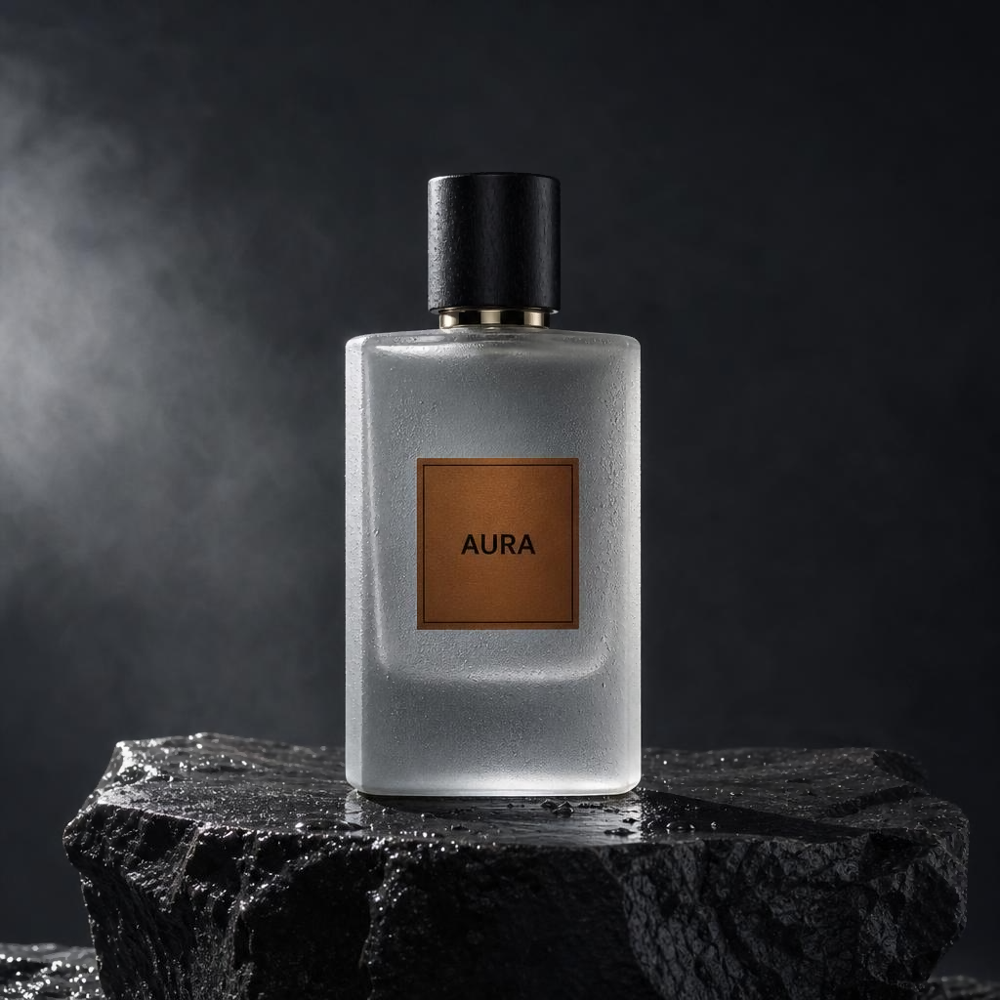</a> <b>Product Hero Perfume</b> 1:1 · 1K</td>
<td width="33%" valign="top"> <b>Cinematic Street Rain</b> 16:9 · 1K</td>
<td width="33%" valign="top"><a href="assets/02-food-overhead-ramen.png">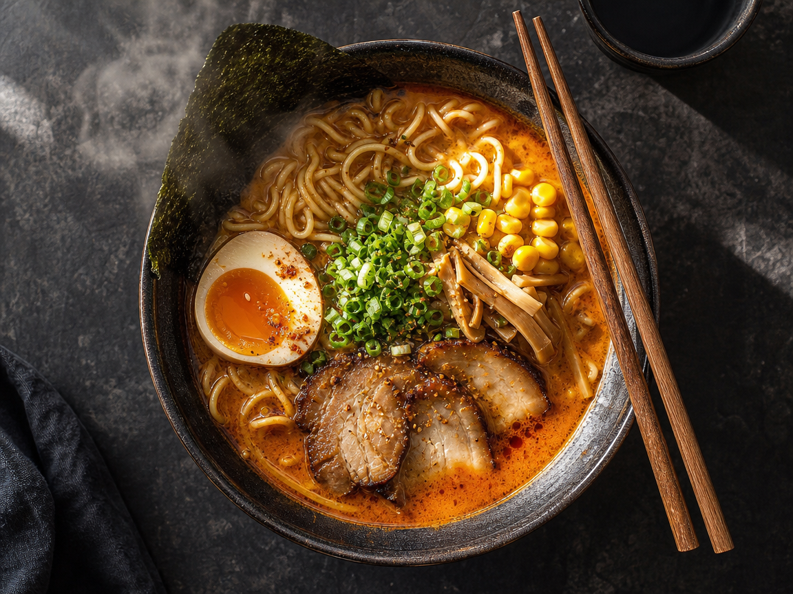</a> <b>Food Overhead Ramen</b> 4:3 · 1K</td>
</tr>
<tr>
<td width="33%" valign="top"> <b>Architectural Dusk</b> 16:9 · 1K</td>
<td width="33%" valign="top"> <b>Illustration Layered Paper</b> 1:1 · 1K</td>
<td width="33%" valign="top"><a href="assets/05-fashion-editorial-studio.png">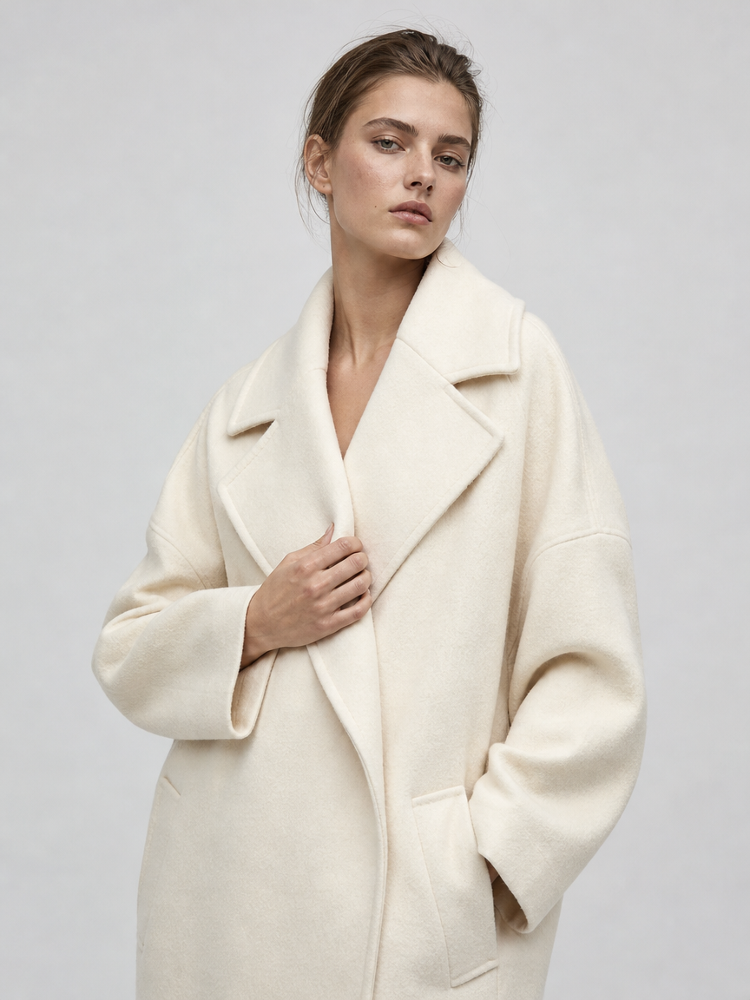</a> <b>Fashion Editorial Studio</b> 3:4 · 1K</td>
</tr>
<tr>
<td width="33%" valign="top"><a href="assets/08-macro-botanical-detail.png">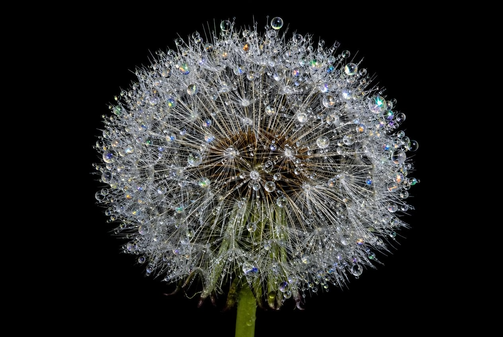</a> <b>Macro Botanical Detail</b> 3:2 · 1K</td>
<td width="33%" valign="top"><a href="assets/07-infographic-dashboard.png">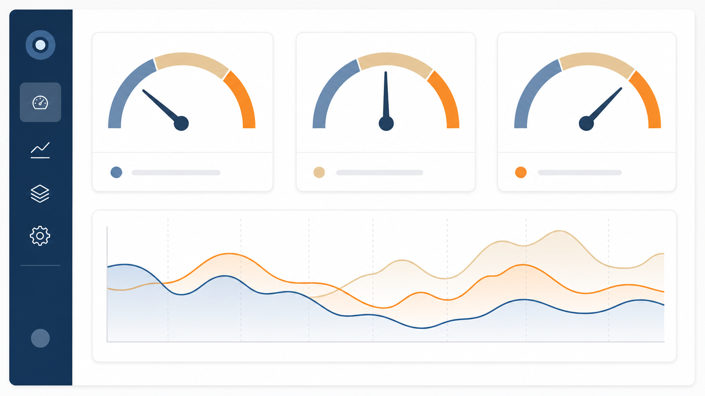</a> <b>Infographic Dashboard</b> 16:9 · 1K</td>
<td width="33%" valign="top"><a href="assets/03-product-cosmetics-duo.png">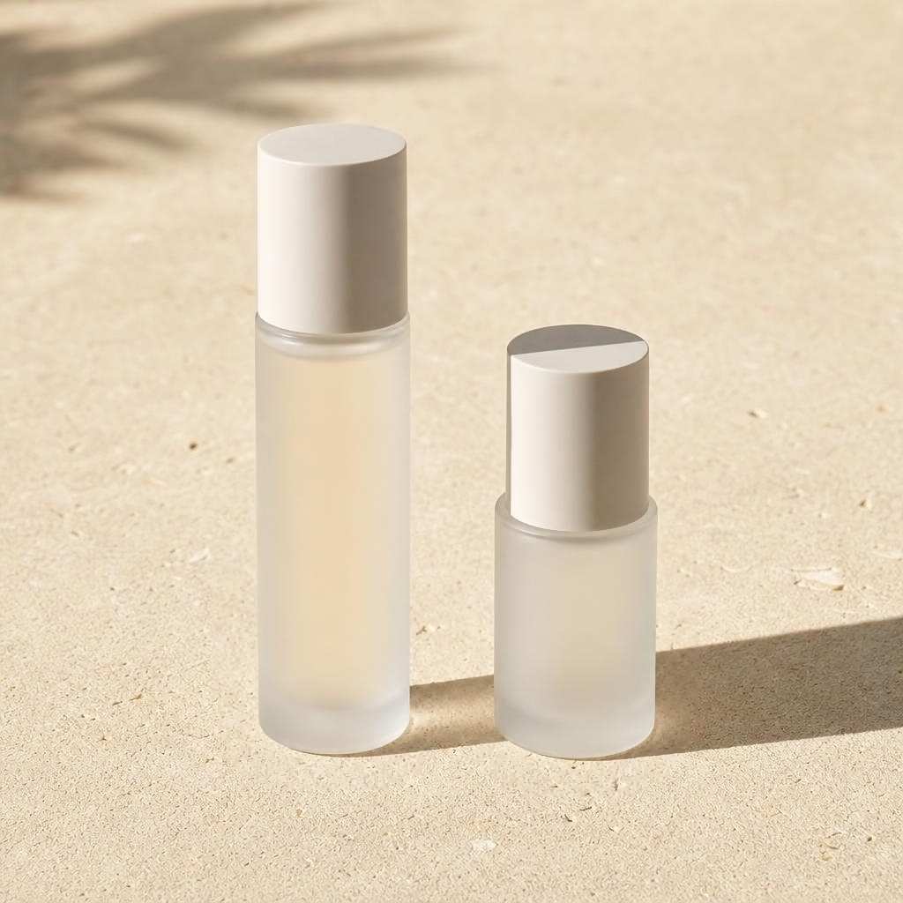</a> <b>Product Cosmetics Duo</b> 1:1 · 1K</td>
</tr>
<tr>
<td width="33%" valign="top"><a href="assets/01-cyberpunk-motorbike.png">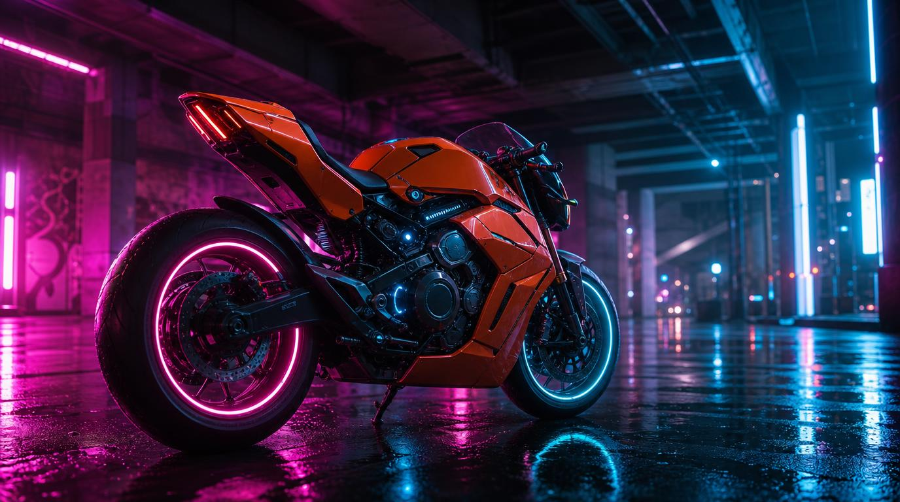</a> <b>Cyberpunk Motorbike</b> 16:9 · 1K</td>
<td width="33%" valign="top"><a href="assets/02-mythic-creature-concept.png">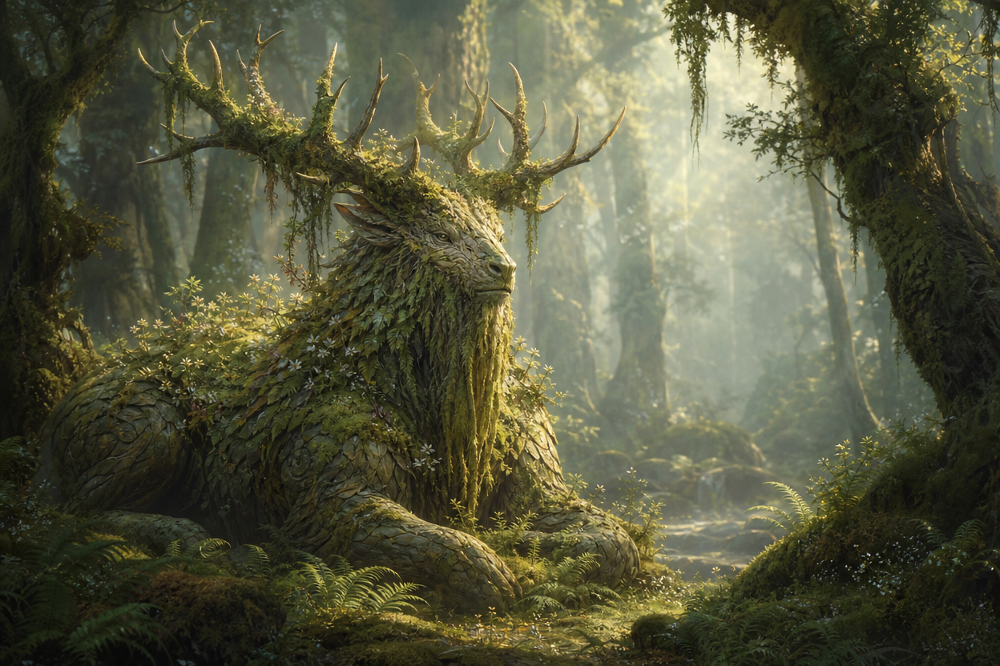</a> <b>Mythic Creature Concept</b> 3:2 · 1K</td>
<td width="33%" valign="top"><a href="assets/04-retro-poster-travel.png">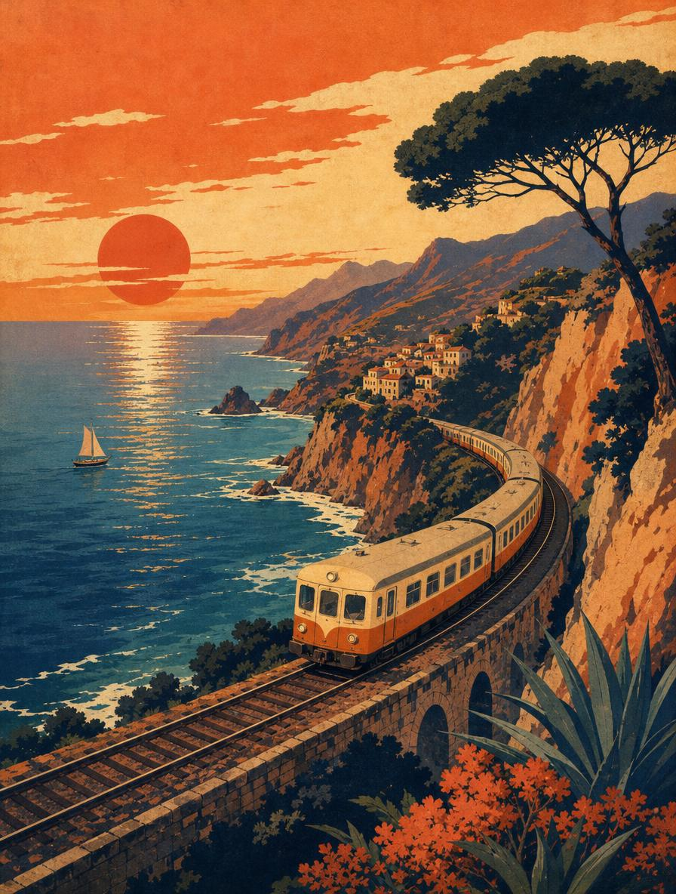</a> <b>Retro Poster Travel</b> 3:4 · 1K</td>
</tr>
<tr>
<td width="33%" valign="top"><a href="assets/05-gourmet-dessert.png">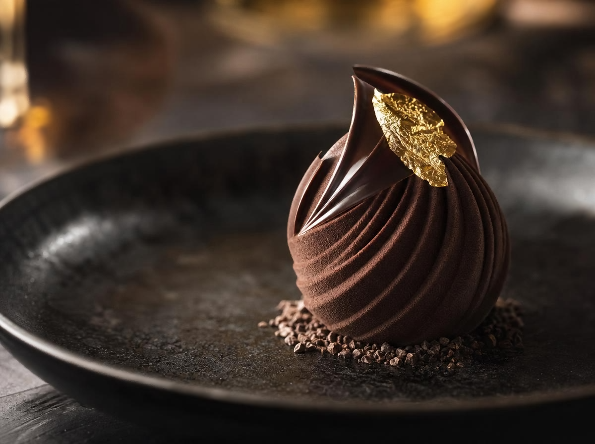</a> <b>Gourmet Dessert</b> 4:3 · 1K</td>
<td width="33%" valign="top"><a href="assets/06-fantasy-city-aerial.png">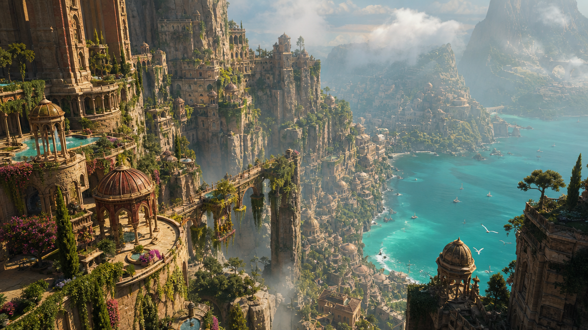</a> <b>Fantasy City Aerial</b> 16:9 · 1K</td>
</tr>
</table>

点击图片可打开原图。所有素材通过 ToAPIs 重新生成，没有复制参考仓库图片。完整提示词见 [PROMPTS.md](PROMPTS.md)。

## 复现案例

生成工具复用已有 quickstart.py 的请求与轮询函数，补上各案例的比例和图片保存。

~~~bash
python examples/generate_gallery.py --id 01-product-hero-perfume --dry-run
python examples/generate_gallery.py --id 01-product-hero-perfume --env-file /path/to/private.env --workers 14 --rpm 240
~~~

需要 Python 3.10 或以上，生图只使用标准库。Windows 可以用 py 替代 python。环境文件中配置 TOAPIS_API_KEY 和可选的 TOAPIS_BASE_URL，真实环境文件放在仓库外。

不传 --id 会处理全部案例，--workers 14 可并发执行；完整批量与逐条命令见 [COMMANDS.md](COMMANDS.md)。已完成的输出跳过，已确认任务 ID 的请求继续查询；提交中断但未拿到任务 ID 时，先检查后台任务，避免重复提交。

## 参数与实际尺寸

| 案例 | 请求比例 | 实际像素 |
| --- | --- | --- |
| Product Hero Perfume | 1:1 | 1024×1024 |
| Cinematic Street Rain | 16:9 | 1696×960 |
| Food Overhead Ramen | 4:3 | 1152×864 |
| Architectural Dusk | 16:9 | 1280×720 |
| Illustration Layered Paper | 1:1 | 1024×1024 |
| Fashion Editorial Studio | 3:4 | 864×1152 |
| Macro Botanical Detail | 3:2 | 1264×848 |
| Infographic Dashboard | 16:9 | 1280×720 |
| Product Cosmetics Duo | 1:1 | 1024×1024 |
| Cyberpunk Motorbike | 16:9 | 1376×768 |
| Mythic Creature Concept | 3:2 | 1248×832 |
| Retro Poster Travel | 3:4 | 896×1184 |
| Gourmet Dessert | 4:3 | 1200×896 |
| Fantasy City Aerial | 16:9 | 1280×720 |

模型固定 gpt-image-2，resolution 字段固定 1k，n 为 1。1K 是分辨率档位，不表示所有比例的最长边都只有 1024 像素。接口返回尺寸与文档对照表有差异，表格分别记录请求比例和实际像素；微小比例偏差记录在任务文件中。保留 API 原图，不裁切、不放大。

[接口文档](https://docs.toapis.com/docs/en/api-reference/images/gpt-image-2/generation) · [完整提示词与参数](data/recipes.json)

## 生成记录与费用

data/runs/ 保存脱敏请求、任务 ID、完成时间、实际像素和图片校验值。展示的是单次成功生成案例，不是稳定性测试。

没有沿用竞品费用；接口没提供费用时保留 null。实际扣费以同账户 Usage Logs 为准，预算前查看当前价格。

## 来源与改写

提示词改写自两个 MIT 许可的参考图集，保留题材与比例，调整光线、配色、材质或约束。全部图片通过 ToAPIs 使用 gpt-image-2 重新生成。

每条提示词的来源仓库、原案例 ID 和源文件版本保存在 data/recipes.json。版权及许可见 [THIRD_PARTY_NOTICES.md](THIRD_PARTY_NOTICES.md)。

## 关于 ToAPIs

本项目由 ToAPIs 维护，用于展示其图像 API。模型名称属于对应权利方，ToAPIs 是第三方 API 服务。

[用 ToAPIs 生成图片](https://toapis.com/dashboard/tokens?utm_source=github&utm_medium=organic_repo&utm_campaign=gh_gpt_image_prompts&utm_content=readme_bottom_key)

实测时间见任务记录。许可证：[MIT](LICENSE)，并保留上游提示词许可。
